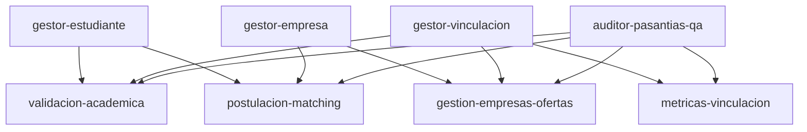

# Agentes Especializados del Sistema Web de Control de Pasantías

Este directorio documenta los agentes especializados configurados y registrados para operar sobre la plataforma, cada uno alineado a un actor clave o fase del flujo de negocio.

---

## Catálogo de Agentes

| Agente | Rol Principal | Casos de Uso | Fases de Negocio |
|---|---|---|---|
| **`gestor-estudiante`** | Gestión del ciclo de vida del Estudiante | CU-01, CU-02, CU-03, CU-04 | Fase 1 (Validación) y Fase 3 (Descubrimiento y Postulación) |
| **`gestor-empresa`** | Gestión del ciclo de vida Empresarial | CU-05, CU-06, CU-07 | Fase 2 (Publicación) y Fase 4 (Evaluación y Matching) |
| **`gestor-vinculacion`** | Gestión Institucional y Gobernanza | CU-08, CU-09, CU-10 | Fase 1 (Aprobación) y Supervisión Transversal |
| **`auditor-pasantias-qa`**| Aseguramiento de Calidad y Verificación | CU-01 al CU-10 | Flujo End-to-End Completo (Fases 1 a 4) |

---

## Mapeo de Skills por Agente

---

## 1. `gestor-estudiante`
*   **Propósito**: Controla que el estudiante registre su perfil socio-académico completo, explore vacantes afines a su carrera y envíe postulaciones formales.
*   **Regla Mandatoria**: Verifica que la matrícula esté activa y que el año académico sea estrictamente 4to o 5to (`anio_academico IN (4, 5)`).
*   **Skills vinculadas**: `validacion-academica`, `postulacion-matching`.

## 2. `gestor-empresa`
*   **Propósito**: Acompaña el alta de empresas receptoras, la publicación de vacantes estructuradas y la evaluación de candidatos en el embudo de selección.
*   **Regla Mandatoria**: Exige estado de aprobación de la empresa antes de publicar y ejecuta la transición atómica a `Experiencia` al seleccionar candidatos.
*   **Skills vinculadas**: `gestion-empresas-ofertas`, `postulacion-matching`.

## 3. `gestor-vinculacion`
*   **Propósito**: Ejerce la auditoría académica institucional, aprueba la vinculación de empresas y genera analítica de absorción y demanda.
*   **Regla Mandatoria**: Monitoreo estricto del cumplimiento normativo para proteger al estudiante y certificar las pasantías.
*   **Skills vinculadas**: `validacion-academica`, `gestion-empresas-ofertas`, `metricas-vinculacion`.

## 4. `auditor-pasantias-qa`
*   **Propósito**: Evalúa la integridad transaccional, previene colisiones o duplicidades, verifica auditorías forenses y ejecuta pruebas de regresión.
*   **Skills vinculadas**: Todas las skills del catálogo.
