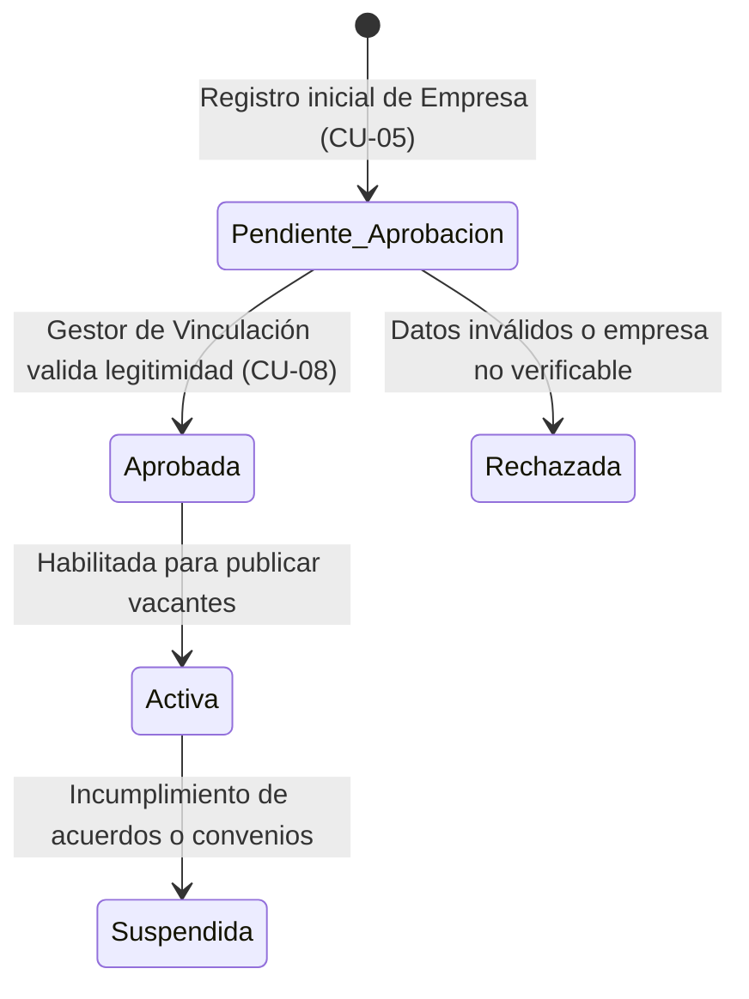

# Skill: Gestión de Empresas y Publicación de Ofertas

Esta skill define el protocolo de incorporación de empresas, su proceso de validación institucional y la estructuración de vacantes de pasantía con criterios técnicos y académicos.

---

## 1. Ciclo de Vida de la Empresa Receptora (CU-05 y CU-08)

### Reglas de Validación de Empresa
1.  **Registro Inicial (CU-05)**:
    *   La empresa proporciona razón social, tipo de organización (*Pública, Privada, ONG, Mixta*), persona de contacto, teléfono y correo electrónico corporativo.
    *   Debe registrar al menos un Supervisor Institucional (`supervisores_institucionales`) vinculado a la entidad.
2.  **Aprobación Institucional (CU-08)**:
    *   El Administrador de Vinculación revisa la documentación de la empresa antes de otorgar el alta definitiva.
    *   Una empresa no aprobada no puede hacer visibles sus ofertas al estudiantado.

---

## 2. Publicación de Ofertas de Pasantía (CU-06 y Fase 2)

Al crear una vacante en `ofertas_pasantia`, se deben configurar los siguientes parámetros obligatorios:

| Campo | Tipo | Regla de Negocio |
|---|---|---|
| `titulo` | String | Nombre claro de la posición (ej. "Pasantía en Desarrollo Web"). |
| `tipo` | Enum | `Académica` o `Profesional`. |
| `modalidad` | Enum | `Presencial`, `Virtual`, `Híbrida`. |
| `duracion_horas` | Entero | Horas formativas requeridas (mínimo 160H, habitual 240H o 320H). |
| `id_carrera` / `sector` | FK / String | Carrera universitaria objetivo a la que se orienta la pasantía. |
| `requisitos` | Texto | Requisitos técnicos (lenguajes, frameworks) y habilidades blandas (comunicación, trabajo en equipo). |
| `cupos` | Entero | Cantidad de plazas disponibles para la vacante (mínimo 1). |
| `condiciones` | String | Especificación de horario y si es *Remunerada* (estipendio/ayuda económica) o *No remunerada*. |

### Procedimiento de Guardado y Auditoría
Al persistir la oferta:
1.  Verificar que la entidad receptora esté en estado aprobado.
2.  Registrar la oferta en `ofertas_pasantia` en estado `Activo`.
3.  Registrar la operación en `auditoria_cambios` (`operacion='INSERT'`).
