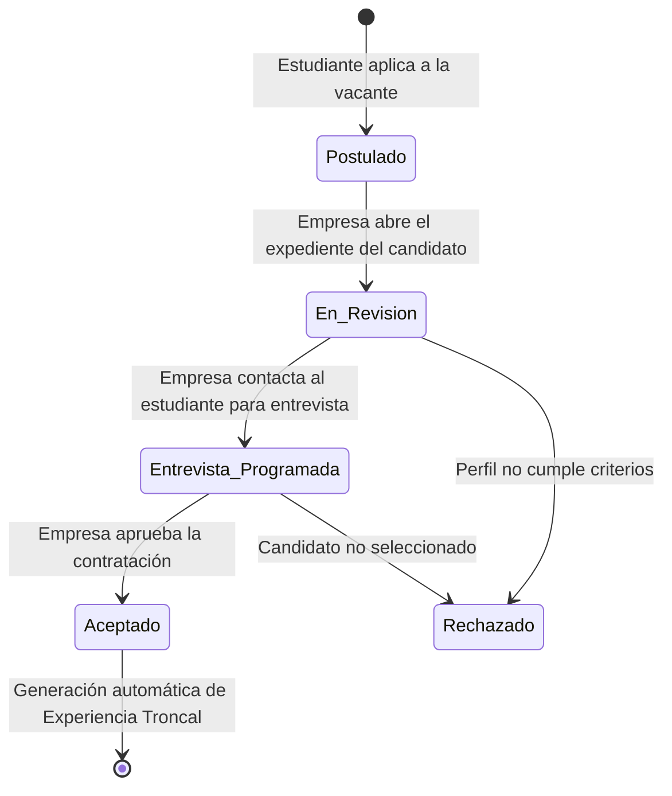

# Skill: Postulación, Evaluación de Candidatos y Matching

Esta skill gobierna la interacción entre el estudiante que busca vacantes y la empresa que evalúa candidatos y formaliza la vinculación académica-laboral.

---

## 1. Descubrimiento y Filtrado (CU-02 y Fase 3)

El estudiante explora la bolsa de trabajo virtual aplicando filtros dinámicos:
*   **Filtro por Carrera Afín**: Muestra preferentemente las ofertas configuradas para la carrera del estudiante.
*   **Filtro por Modalidad**: `Presencial`, `Virtual` o `Híbrida`.
*   **Filtro Territorial**: Por departamento o municipio de la sede laboral.
*   **Búsqueda Libre**: En título, descripción y requisitos técnicos de la vacante.

---

## 2. Envío de Postulación (CU-03 y Fase 3)

### Validación Previa a la Postulación
Antes de crear el registro en `aplicaciones_oferta`:
1.  **Validar Elegibilidad**: El estudiante debe contar con matrícula activa en 4to o 5to año (invocar skill `validacion-academica`).
2.  **Validar Estado de Oferta**: La oferta debe estar en estado `Activo`.
3.  **Prevención de Duplicados**: Comprobar que no exista una postulación previa del mismo estudiante a la misma oferta (`uq_oferta_estudiante_aplicacion`).
4.  **Adjuntar Expediente**: Vincular el perfil socio-académico (`id_estudiante`) y notas/mensaje de motivación del estudiante.

---

## 3. Estados de la Postulación y Evaluación (CU-04 y CU-07)

### Reglas para la Empresa (CU-07)
*   La empresa solo visualiza perfiles validados por la universidad.
*   La empresa puede avanzar el estado de la postulación:
    *   `En revision`: Indica que el CV y antecedentes están siendo examinados.
    *   `Entrevista programada`: Indica fecha de contacto técnico o de RRHH.
    *   `Aceptado`: Decisión formal de selección.
    *   `Rechazado`: Cierre de la postulación con retroalimentación.

---

## 4. Formalización y Transición a Experiencia (Fase 4)

Cuando la postulación transiciona al estado **`Aceptado`**, el backend debe ejecutar una transacción atómica que:
1.  Actualice `aplicaciones_oferta.estado = 'Aceptada'`.
2.  Cree el registro troncal en `experiencias`:
    *   `tipo_experiencia = 'Pasantia'`
    *   `id_estudiante = aplicacion.id_estudiante`
    *   `modalidad = oferta.modalidad`
    *   `horas_totales = oferta.duracion_horas`
    *   `origen = 'Convocatoria_Institucional'`
    *   `estado = 'En_Proceso'`
3.  Cree la especialización en `pasantias` (`tipo = oferta.tipo`).
4.  Cree la asignación inicial en `asignaciones_experiencia` con el supervisor de la empresa (`id_entidad = oferta.id_entidad`, `rol = 'Supervisor'`).
5.  Vincule `aplicaciones_oferta.id_experiencia_generada = experiencia.id_experiencia`.
6.  Registre la auditoría en `auditoria_cambios`.
