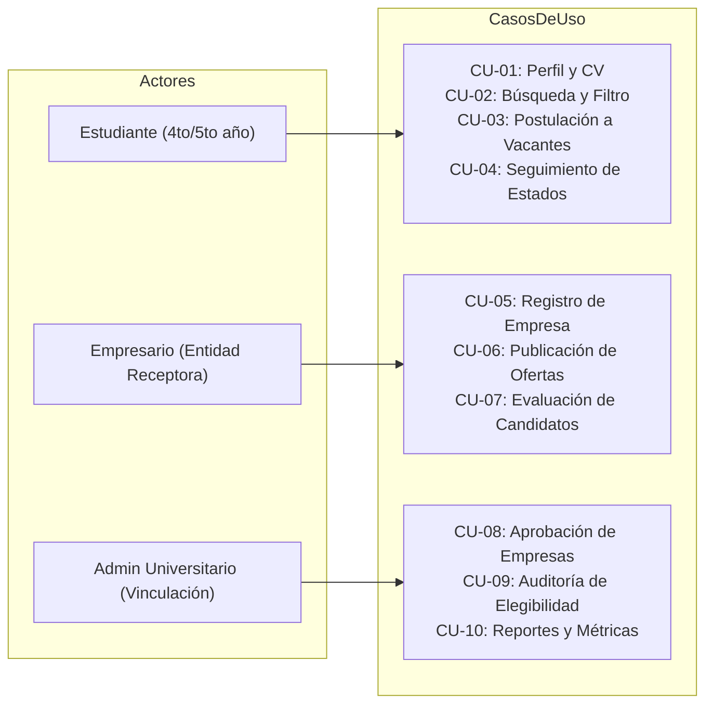
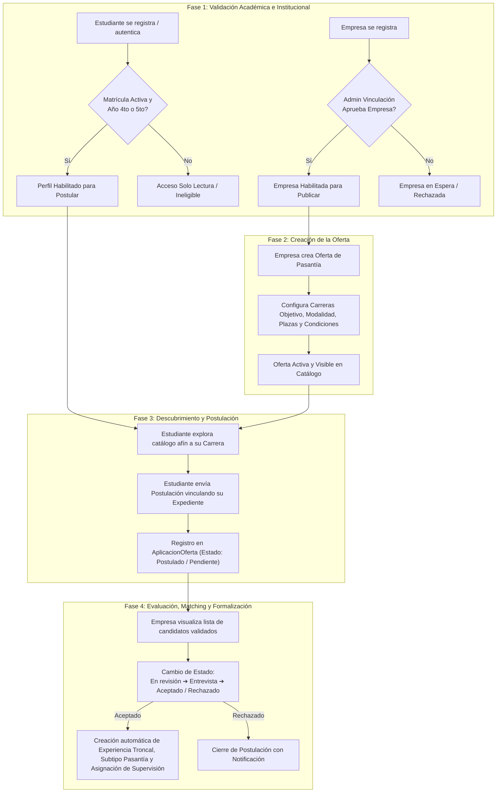

# Reglas de Negocio y Arquitectura: Sistema Web de Control de Pasantías

Este documento establece las **reglas de negocio fundamentales**, los **casos de uso formales** y el **flujo de trabajo integral (End-to-End)** que cualquier agente, desarrollador o proceso automatizado debe respetar al operar sobre este repositorio.

---

## 1. Actores y Casos de Uso del Dominio

### A. Estudiante (Universitario de 4to o 5to año)
*   **CU-01: Gestión de Perfil y CV**:
    *   Debe registrar y actualizar sus datos socio-demográficos (`estudiantes`, `direcciones_estudiante`, `telefonos_estudiante`).
    *   Debe adjuntar antecedentes académicos y de educación previa (`educacion_previa_estudiante`).
    *   **Regla Institucional Obligatoria**: La postulación solo es válida si su matrícula académica (`matriculas`) se encuentra en estado `Activa` y su año académico (`anio_academico`) es estrictamente `4` o `5`.
*   **CU-02: Búsqueda y Filtrado de Ofertas**:
    *   Exploración del catálogo de ofertas (`ofertas_pasantia`) con filtrado multicriterio: carrera universitaria afín (`id_carrera`), modalidad (*Presencial*, *Virtual*, *Híbrida*), ubicación territorial (*Ciudad/Municipio*) y tipo de beca si aplica.
*   **CU-03: Postulación a Vacantes**:
    *   Envío de postulación formal (`aplicaciones_oferta`).
    *   Inmutabilidad de duplicados: Un estudiante solo puede tener una postulación activa por oferta (`uq_oferta_estudiante_aplicacion`).
    *   Adjunta el expediente y documentación requerida por la empresa receptora.
*   **CU-04: Seguimiento de Postulaciones**:
    *   Monitoreo reactivo del estado de sus solicitudes: `Postulado` (o `Pendiente`), `En revisión`, `Entrevista programada`, `Aceptado`, `Rechazado`.

### B. Empresario / Administrador de Empresa (Entidad Receptora)
*   **CU-05: Registro y Validación de Empresa**:
    *   Registro de la entidad receptora (`entidades_receptoras`) con razón social, sector, datos de contacto y designación de supervisor (`supervisores_institucionales`).
    *   **Regla de Seguridad**: Toda empresa recién registrada inicia en estado `Pendiente_Aprobacion` y no puede publicar ofertas activas hasta que el Gestor de Vinculación valide su legitimidad.
*   **CU-06: Publicación de Ofertas de Pasantía**:
    *   Creación de vacantes con especificación estructurada:
        1.  Requisitos técnicos y habilidades blandas requeridas.
        2.  Carreras universitarias objetivo (vinculación estricta con estudiantes de 4to o 5to año).
        3.  Cantidad de plazas disponibles (`cupos`), horarios y condiciones (*Remunerada* / *No remunerada*).
*   **CU-07: Evaluación de Candidatos**:
    *   Revisión de postulantes validados por el padrón institucional.
    *   Filtro y preselección de perfiles elegibles.
    *   Transición de estados de postulación y toma de decisiones de contratación.

### C. Administrador Universitario (Gestor de Vinculación)
*   **CU-08: Aprobación de Empresas**:
    *   Verificación y validación de la legitimidad de las empresas registradas para salvaguardar la seguridad e integridad del estudiantado.
*   **CU-09: Auditoría de Elegibilidad**:
    *   Monitoreo continuo y estricto de que los postulantes cumplan las condiciones normativas universitarias: matrícula vigente (`estado == 'Activa'`) y avance de carrera en 4to o 5to año (`anio_academico IN (4, 5)`).
*   **CU-10: Reportes y Métricas Institucionales**:
    *   Generación de reportes analíticos sobre demanda de pasantías por carrera y absorción de talento por sector empresarial.

---

## 2. Flujo de Trabajo End-to-End (4 Fases)

---

## 3. Reglas Técnicas y Estándares de Implementación

1.  **Integridad Transaccional**:
    *   Toda transición a estado `Aceptado` en una postulación debe generar de forma atómica el registro en `experiencias`, `pasantias` y `asignaciones_experiencia`.
2.  **Seguridad y Auditoría**:
    *   Las contraseñas de todos los actores se hashean con PBKDF2:SHA256 (`Usuario.set_password`).
    *   Todo cambio de estado en ofertas o postulaciones debe auditarse en `auditoria_cambios`.
    *   Todo intento de sesión de cualquier actor debe auditarse en `auditoria_sesiones`.
3.  **No Modificación de Reglas sin Aprobación**:
    *   Ningún componente nuevo puede permitir la postulación de estudiantes que no pertenezcan al 4to o 5to año académico con matrícula activa.
